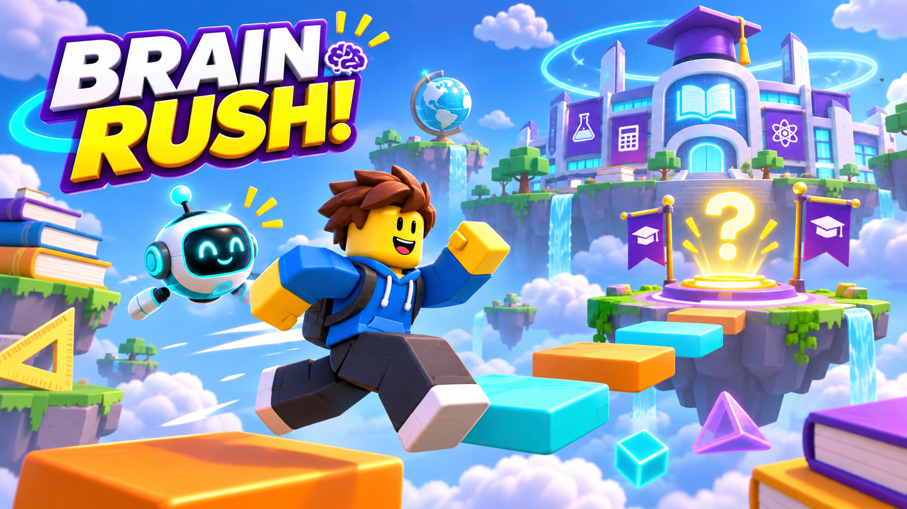
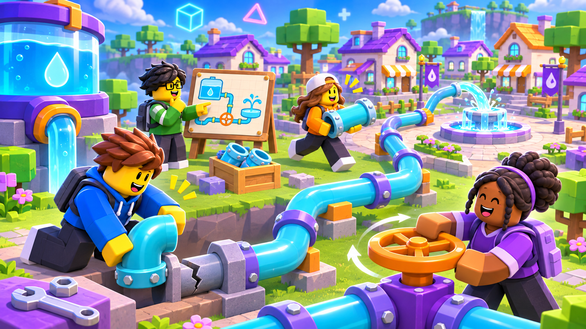

<h1 align="center">🧠 BRAIN RUSH!</h1>

<strong>Salta, piensa y resuelve. Solo o con tu equipo.</strong>

<em>Arte conceptual de la propuesta. El juego todavía no está implementado.</em>

## ¿Qué es BRAIN RUSH!?

**BRAIN RUSH!** es una propuesta de juego educativo en **Roblox**, pensada para escuelas. Combina la aventura de un parkour con preguntas y la emoción de resolver una misión entre amigos.

La experiencia se divide en **dos modos**: un recorrido individual con un asistente de inteligencia artificial y un modo cooperativo con problemas que requieren el aporte de varios estudiantes.

El objetivo es que los estudiantes practiquen conocimientos, reciban ayuda cuando la necesiten y aprendan a trabajar juntos. Para la escuela, la propuesta busca ofrecer información sobre los temas que dominan y los que necesitan reforzar.

## 🏃 Modo individual: parkour con IA

El estudiante recorre una pista de obstáculos dividida en etapas. Entre saltos, plataformas y puntos de control encuentra preguntas del ciclo escolar seleccionado.

### ¿Cómo sería una partida?

1. El estudiante elige el área de aprendizaje y el ciclo que le corresponde.
2. Supera un tramo de parkour hasta llegar a una estación de preguntas.
3. Responde una pregunta para desbloquear el siguiente tramo.
4. Si necesita ayuda, consulta al compañero de IA que lo acompaña.
5. Si se equivoca, recibe una explicación y puede volver a intentarlo.
6. Continúa desde los puntos de control hasta completar el recorrido.

**Ejemplo:** después de cruzar unas plataformas flotantes, una puerta presenta una pregunta de matemática. Resolverla permite abrir el camino hacia la siguiente zona.

### 🤖 Un compañero de IA a tu lado

El asistente se representa como un personaje que acompaña al jugador durante el recorrido. Su función es ayudarlo a comprender y llegar a su propia respuesta.

- Reformular una pregunta con palabras más sencillas.
- Dar pistas progresivas cuando el estudiante se atasca.
- Explicar un concepto con ejemplos apropiados para su nivel.
- Ayudar a comprender un error antes de volver a intentarlo.
- Animar al estudiante a seguir avanzando.

La propuesta es que **la IA oriente y el estudiante resuelva**. Su diseño visual, nombre y funcionamiento técnico se definirán durante el desarrollo.

### Progreso y aprendizaje

Se propone registrar las respuestas, los intentos y las pistas utilizadas para identificar temas por reforzar. El desempeño académico se distinguirá del desempeño en el parkour: saltar mejor o terminar más rápido no equivale a saber más.

## 🤝 Modo cooperativo: misiones en equipo

*Ilustración conceptual de una posible misión cooperativa.*

Varios estudiantes entran a un escenario con un problema amplio que deben resolver juntos. Investigan, comparten información, reparten tareas y acuerdan una solución.

Cada integrante tendrá una contribución necesaria para avanzar. La colaboración forma parte de la misión: el equipo necesita combinar lo que descubre y lo que sabe cada jugador.

### Ejemplo de misión: ¡la comunidad se quedó sin agua!

Una comunidad necesita recuperar su suministro de agua. El equipo debe:

- Investigar dónde está el problema y reunir pistas.
- Calcular la cantidad de agua que necesita la población.
- Elegir materiales y distribuir recursos limitados.
- Coordinar acciones para reparar el sistema.
- Comprobar la solución y explicar por qué funciona.

Este escenario es un ejemplo de diseño. Las misiones concretas se elegirán según los contenidos educativos y la dificultad apropiada para los estudiantes.

## 📚 Áreas, ciclos e idiomas

Los contenidos se organizarán por **áreas de aprendizaje** y por **primer, segundo y tercer ciclo**, tal como plantea la idea inicial. La equivalencia con grados escolares y los contenidos de cada ciclo están pendientes de definir con el equipo educativo.

Como áreas iniciales se pueden explorar matemática, comunicación y ciencias. Una misma misión cooperativa podría combinar varias de ellas.

También se contempla incorporar **diferentes lenguas**, tanto en textos y actividades como en la organización de grupos por idioma. La primera lengua, las siguientes traducciones y la distribución de salas o servidores se decidirán más adelante.

## 🎯 Primera versión propuesta

Para validar la idea, se propone comenzar con una experiencia pequeña y jugable:

- Un espacio de entrada para elegir entre los dos modos.
- Un área de aprendizaje y un ciclo escolar.
- Un parkour corto con preguntas y puntos de control.
- Un compañero de IA con ayudas guiadas.
- Una misión cooperativa con un problema y un objetivo compartido.
- Un resumen básico de avance y temas por reforzar.

El alcance exacto se acordará antes de programar. Después se podrán ampliar áreas, ciclos, idiomas y misiones.

## 🚧 Estado del proyecto

**Etapa actual: definición de la idea.** Este repositorio contiene la presentación del concepto y sus ilustraciones. Todavía no incluye código del juego, un mapa jugable ni una integración de IA.

- [x] Definir el nombre: **BRAIN RUSH!**.
- [x] Documentar los dos modos de juego.
- [x] Añadir arte conceptual para comunicar la propuesta.
- [ ] Precisar los grados y contenidos de cada ciclo.
- [ ] Acordar el alcance de la primera versión.
- [ ] Preparar el proyecto de Roblox Studio y su estructura de código.
- [ ] Construir y probar el primer recorrido y la primera misión.

## 🎨 Sobre las imágenes

Las imágenes fueron generadas con IA para ilustrar la idea con una estética de avatares y escenarios de Roblox. **Son arte conceptual; no son capturas de un juego desarrollado.** Los prompts y detalles de generación se conservan en [Arte conceptual](docs/arte-conceptual.md).
