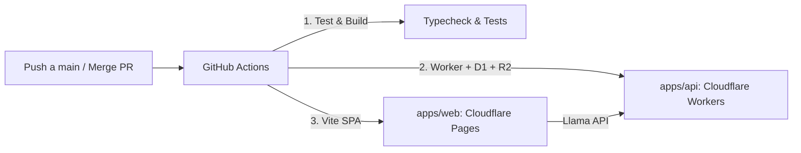

# Guía de Despliegue Continuo en Cloudflare (Workers & Pages)

Esta guía documenta la infraestructura de CI/CD para desplegar **BRAIN RUSH** en Cloudflare automáticamente cada vez que se hace un `push` a `main` o se aprueba/mergea un Pull Request.

---

## 🏗️ Arquitectura de Despliegue



1. **Frontend (`apps/web`):**
   - Alojado en **Cloudflare Pages** como Single Page Application (SPA).
   - Enrutamiento soportado mediante `_redirects` (`/* /index.html 200`).
   - Caché inmutable y cabeceras de seguridad vía `_headers`.

2. **Backend (`apps/api`):**
   - Alojado en **Cloudflare Workers** (`brain-rush-api`).
   - Base de datos relacional en **Cloudflare D1** (`brain-rush`).
   - Almacenamiento de archivos y escaneos en **Cloudflare R2** (`brain-rush-files`).
   - CORS multi-origen configurado para permitir dominios `*.pages.dev` y `localhost`.

---

## 🔑 1. Variables y Secretos a Configurar en GitHub

En tu repositorio de GitHub, dirígete a:
**Settings** ➔ **Secrets and variables** ➔ **Actions**.

### A. Repository Secrets (Secretos Cifrados)
Haz clic en **New repository secret**:

| Nombre del Secreto | Descripción | ¿Dónde obtenerlo? |
|---|---|---|
| `CLOUDFLARE_API_TOKEN` | Token de API con permisos para Workers, Pages, D1 y R2. | Cloudflare Dashboard (ver paso 2). |
| `CLOUDFLARE_ACCOUNT_ID` | Identificador de tu cuenta en Cloudflare. | Cloudflare Dashboard (en la barra lateral derecha o URL). |
| `MISTRAL_API_KEY` | Llave de API para el modelo de IA que genera y evalúa las sesiones. | [console.mistral.ai](https://console.mistral.ai/) |
| `CLOUDFLARE_D1_DATABASE_ID` | *(Opcional)* UUID de la base de datos D1 creada. Si no lo pones aquí, puedes colocarlo directamente en `apps/api/wrangler.toml`. | Al ejecutar `npx wrangler d1 create brain-rush` o en el panel de D1. |

### B. Repository Variables (Variables Públicas de Entorno)
En la pestaña **Variables** (junto a Secrets), haz clic en **New repository variable**:

| Nombre de la Variable | Valor Recomendado | Descripción |
|---|---|---|
| `VITE_API_URL` | `https://brain-rush-api.<tu-subdominio>.workers.dev` | URL pública de tu Cloudflare Worker una vez desplegado. Vite inyectará esta URL durante el build. |

---

## ☁️ 2. Configuración en el Panel de Cloudflare

### Paso 1: Crear el Token de API en Cloudflare
1. Ve a **My Profile** ➔ **API Tokens** ➔ **Create Token**.
2. Puedes usar la plantilla **Edit Cloudflare Workers** o crear un Custom Token con los siguientes permisos:
   - **Account** ➔ **Cloudflare Pages** ➔ **Edit**
   - **Account** ➔ **Workers Scripts** ➔ **Edit**
   - **Account** ➔ **Workers KV Storage** ➔ **Edit** *(opcional)*
   - **Account** ➔ **D1** ➔ **Edit**
   - **Account** ➔ **R2 Storage** ➔ **Edit**
3. En **Account Resources**, selecciona tu cuenta.
4. Guarda el token generado y cópialo en el secreto `CLOUDFLARE_API_TOKEN` de GitHub.

### Paso 2: Crear la Base de Datos D1
En tu terminal local o mediante el dashboard:
```bash
npx wrangler d1 create brain-rush
```
Salida esperada:
```text
✅ Successfully created DB 'brain-rush'!
[[d1_databases]]
binding = "DB"
database_name = "brain-rush"
database_id = "xxxxxxxx-xxxx-xxxx-xxxx-xxxxxxxxxxxx"
```
Copia el `database_id` en `apps/api/wrangler.toml` o en el secreto de GitHub `CLOUDFLARE_D1_DATABASE_ID`.

### Paso 3: Crear el Bucket R2
```bash
npx wrangler r2 bucket create brain-rush-files
```

### Paso 4: Crear el Proyecto en Cloudflare Pages
1. Ve a **Workers & Pages** ➔ **Create application** ➔ **Pages**.
2. Puedes crear un proyecto vacío con el nombre exacto:
   `brain-rush-web`
3. Cuando GitHub Actions ejecute el flujo por primera vez, subirá automáticamente la carpeta `apps/web/dist` a este proyecto.

---

## 🚀 3. Flujo Automatizado de CI/CD

El repositorio cuenta con dos flujos en `.github/workflows/`:

1. **`ci.yml` (Integración Continua):**
   - Se ejecuta en **Pull Requests** hacia `main` y en commits a `main`.
   - Ejecuta `typecheck`, pruebas de motor (`npm test`) y compila todos los paquetes para garantizar que ningún cambio rompa el código.

2. **`deploy.yml` (Despliegue Continuo):**
   - Se ejecuta automáticamente tras cada **push a `main`** o **merge de PR**.
   - Aplica migraciones remotas de D1.
   - Despliega el Worker API.
   - Compila la web inyectando la URL de producción y la despliega en Cloudflare Pages.
