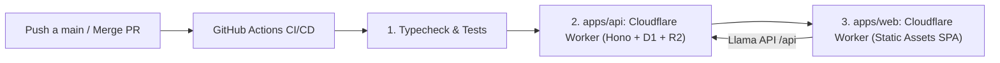

# Guía de Despliegue Continuo en Cloudflare Workers (Full Workers)

Esta guía documenta la infraestructura de CI/CD para desplegar **BRAIN RUSH** 100% en Cloudflare Workers automáticamente cada vez que se hace un `push` a `main` o se aprueba/mergea un Pull Request.

---

## 🏗️ Arquitectura de Despliegue (Workers Nativo)

Toda la aplicación se ejecuta sobre el ecosistema moderno de **Cloudflare Workers** (Workers Static Assets para Frontend y Workers TypeScript para Backend):



1. **Frontend (`apps/web`):**
   - Desplegado como Worker con **Static Assets** (`brain-rush-web`).
   - Enrutamiento SPA nativo mediante `not_found_handling = "single-page-application"` en `wrangler.toml`.
   - Soporte automático para rutas directas en el navegador (`/docente`, `/estudiante`, `/proyectar/:codigo`).
   - Cabeceras inmutables de caché y seguridad vía `_headers`.

2. **Backend (`apps/api`):**
   - Desplegado como Cloudflare Worker (`brain-rush-api`) con framework **Hono**.
   - Base de datos relacional serverless en **Cloudflare D1** (`brain-rush`).
   - Almacenamiento de archivos y escaneos pedagógicos en **Cloudflare R2** (`brain-rush-files`).
   - CORS multi-origen dinámico para admitir dominios `*.workers.dev`, `localhost` y dominios personalizados.

---

## 🔑 1. Variables y Secretos a Configurar en GitHub

En tu repositorio de GitHub, dirígete a:
**Settings** ➔ **Secrets and variables** ➔ **Actions**.

### A. Repository Secrets (Secretos Cifrados)
Haz clic en **New repository secret**:

| Secreto en GitHub | Obligatorio | Descripción | ¿Dónde obtenerlo? |
|---|---|---|---|
| `CLOUDFLARE_API_TOKEN` | **Sí** | Token de API con permisos para desplegar Workers, aplicar migraciones D1 y gestionar R2. | Panel de Cloudflare ➔ **My Profile** ➔ **API Tokens** (ver instrucciones abajo). |
| `CLOUDFLARE_ACCOUNT_ID` | **Sí** | ID de tu cuenta de Cloudflare. | Panel de Cloudflare (columna lateral derecha de la página principal de Workers). |
| `MISTRAL_API_KEY` | **Sí** | Llave de API del modelo Mistral para la extracción pedagógica y generación de juegos. | [console.mistral.ai](https://console.mistral.ai/) ➔ API Keys. |
| `CLOUDFLARE_D1_DATABASE_ID` | *Opcional* | ID (UUID) de la base de datos D1. *(Si prefieres, puedes colocarlo directamente en `apps/api/wrangler.toml`)*. | Al ejecutar `npx wrangler d1 create brain-rush` o en la consola D1 de Cloudflare. |

### B. Repository Variables (Variables Públicas de Entorno)
En la pestaña **Variables** (junto a Secrets), haz clic en **New repository variable**:

| Variable en GitHub | Obligatorio | Valor Recomendado | Descripción |
|---|---|---|---|
| `VITE_API_URL` | **Sí** | `https://brain-rush-api.<tu-subdominio>.workers.dev` | URL pública de tu API desplegada en Cloudflare Workers. Se inyecta en el build de Vite para que el frontend se comunique con la API remota. |

---

## ☁️ 2. Configuración en el Panel de Cloudflare

### Paso 1: Crear el Token de API en Cloudflare
1. Inicia sesión en [dash.cloudflare.com](https://dash.cloudflare.com/).
2. Ve a **My Profile** (arriba a la derecha) ➔ **API Tokens** ➔ **Create Token**.
3. Selecciona **Create Custom Token** y asigna los siguientes permisos:
   - **Account** ➔ **Workers Scripts** ➔ **Edit**
   - **Account** ➔ **D1** ➔ **Edit**
   - **Account** ➔ **R2 Storage** ➔ **Edit**
4. En **Account Resources**: Selecciona `Include` ➔ `All accounts` (o tu cuenta específica).
5. Haz clic en **Continue to summary** y luego en **Create Token**.
6. Copia el token generado y pégalo en GitHub como `CLOUDFLARE_API_TOKEN`.

### Paso 2: Obtener el Account ID
1. En el panel de Cloudflare, ve a **Workers & Pages**.
2. En la barra lateral derecha verás **Account ID**. Cópialo y pégalo en GitHub como `CLOUDFLARE_ACCOUNT_ID`.

### Paso 3: Crear la Base de Datos D1
Desde tu terminal local o mediante la interfaz de Cloudflare:
```bash
npx wrangler d1 create brain-rush
```
Salida esperada:
```text
✅ Successfully created DB 'brain-rush'!
[[d1_databases]]
binding = "DB"
database_name = "brain-rush"
database_id = "xxxxxxxx-xxxx-xxxx-xxxx-xxxxxxxxxxxx"
```
Copia el valor de `database_id` en el secreto de GitHub `CLOUDFLARE_D1_DATABASE_ID` (o en `apps/api/wrangler.toml`).

### Paso 4: Crear el Bucket R2
```bash
npx wrangler r2 bucket create brain-rush-files
```

> [!NOTE]
> No necesitas crear previamente los Workers ni proyectos de Pages en la consola web: Wrangler crea automáticamente los Workers (`brain-rush-api` y `brain-rush-web`) en el primer despliegue ejecutado por GitHub Actions.

---

## 🚀 3. Flujo Automatizado de CI/CD

El repositorio cuenta con dos flujos automáticos en `.github/workflows/`:

1. **`ci.yml` (Integración Continua):**
   - Se ejecuta en cada **Pull Request** hacia `main` y en commits a `main`.
   - Ejecuta `npm run typecheck`, las 64 pruebas unitarias (`npm test`) y la compilación completa de la app.

2. **`deploy.yml` (Despliegue Continuo):**
   - Se ejecuta automáticamente tras cada **push a `main`** o **merge de una PR**.
   - También cuenta con disparador manual (`workflow_dispatch`).
   - Aplica migraciones D1 remotas automáticamente.
   - Despliega el backend `brain-rush-api` en Cloudflare Workers.
   - Compila la aplicación web inyectando `VITE_API_URL` y la despliega en Cloudflare Workers Static Assets (`brain-rush-web`).
